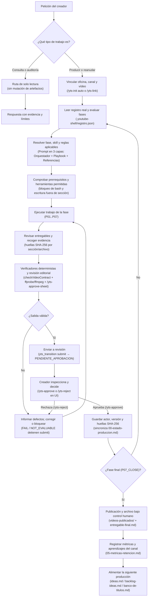

# youtube-shell

Agente de producción de video empaquetado como paquete para [pi](https://github.com/earendil-works/pi).

Tu agente produce videos y después olvida todo: no tiene opinión sobre tu canal y no puede
probar qué hizo más allá de pedirte que revises cada frame. `youtube-shell` le da memoria,
pipeline y evidencia: las fases de producción se controlan en el runtime, las aprobaciones son
solo del creador y quedan atadas a huellas SHA-256 de lo aprobado, y el master se mide contra
una hoja de aceptación escrita antes del render.

## Instalación y uso sobre `pi`

Distribución privada por repositorio Git o ruta local (`"private": true`, no listado en `pi.dev/packages`):

```bash
# Enlazar el comando `youtube-shell` globalmente en tu máquina (crea symlink en ~/.local/bin/youtube-shell)
npm link

# Lanzar directamente en cualquier carpeta de video (home aislado en ~/.youtube-shell/agent)
youtube-shell

# O instalar como paquete desde GitHub sobre pi
pi install git:github.com/albertopo94/youtube-shell
```

### Comandos exclusivos del creador (UI de `pi`)
- `/yts-init`: inicializa las 8 plantillas canónicas (`00`..`06` + `entregable-final.md`), autodetecta el vínculo con la oficina/canal si existe y crea `.youtube-shell/registro.json` en la carpeta actual.
- `/yts-status`: muestra y refresca el resumen de las 7 fases y la siguiente acción permitida.
- `/yts-link <ruta-oficina> [ruta-canal]` (o `/yts-link auto`): vincula la carpeta del video con la oficina (`ideas.md`, `referentes.md`, `banco-visual.md`) y el directorio del canal (`backlog-ideas.md`, `banco-de-titulos.md`).
- `/yts-approve-sheet [ruta-json]`: aprueba criptográficamente la hoja de aceptación previa al render (`aceptacion.json`), registrando su huella SHA-256 y el actor creador en `.youtube-shell/registro.json` antes de validar el master en `P06_ASSEMBLY`.
- `/yts-approve <FASE> [--ack-warn] [nota]`: aprueba una fase en `PENDIENTE_APROBACION`, sellando las huellas SHA-256 de sus artefactos y sincronizando la vista `00-estado-produccion.md`.
- `/yts-reject <FASE> <nota>`: devuelve una fase pendiente a `EN_CURSO` con observaciones.

### Herramientas expuestas al modelo
- `yts_status`: estado determinista de las 7 fases (`P01_PACKAGING`..`P07_CLOSE`) y siguiente acción permitida.
- `yts_transition`: solicita transiciones operativas (`start`, `submit`, `block`, `unblock`, `reopen`) verificando automáticamente el contrato sobre disco.
- `yts_check_contract`: verificador determinista del contrato de archivos, estados normalizados, estructura de packaging (`packaging_structure`), fuentes de investigación (`research_sources_structure`), bloques `[Bxx]` y puerta editorial (`script_block_ids`), fact-checking (`factcheck_resolved`), correspondencia de storyboard (`script_storyboard_ids`), licencias de recursos (`resource_license_log`) y entregables de cierre (`close_deliverables`).
- `yts_measure_master`: mide el archivo master con `ffprobe`/`ffmpeg` (`loudnorm`, `blackdetect`, `silencedetect`, cortes de escena) contra una hoja de aceptación fechada y aprobada antes del render (`PASS | FAIL | WARN | NOT_EVALUABLE`).

### Skills incluidas y referencias normativas
- `yts-orquestador` (`GLOBAL`, `P07_CLOSE`, más `references/contingencia-y-politicas-sensibles.md` y `references/herramientas-y-apis.md`)
- `yts-investigacion-ideas` (`P02_RESEARCH`)
- `yts-packaging-miniaturas` (`P01_PACKAGING`)
- `yts-guion-narrativa` (`P03_SCRIPT`, `P04_FACTCHECK`)
- `yts-direccion-edicion` (`P05_ANIMATIC`, `P06_ASSEMBLY`, `P07_CLOSE`)

## Flujo de producción audiovisual y gobierno en tiempo de ejecución

Cada turno del creador pasa por el clasificador y resolvedor de 3 capas ([`src/core/context-resolver.ts`](src/core/context-resolver.ts)), la compuerta de herramientas ([`src/gate/pi-extension.ts`](src/gate/pi-extension.ts)) y la máquina de estados ([`src/core/machine.ts`](src/core/machine.ts)). También podés consultar la versión visual en [`mermaid-diagram.png`](mermaid-diagram.png).



| Etapa del flujo | Implementación en `youtube-shell` |
|---|---|
| **¿Qué tipo de trabajo es?** | `classifyWorkMode()` en [`src/core/context-resolver.ts`](src/core/context-resolver.ts) separa consultas/auditorías (`read_only`) de producción (`production`), y [`src/gate/pi-extension.ts`](src/gate/pi-extension.ts) bloquea estructuralmente `write`, `edit` y `yts_transition` durante turnos `read_only`. |
| **Vincular oficina, canal y vídeo** | `detectWorkspaceLink()` en `/yts-init` o explícitamente con `/yts-link <oficina> [canal]`. |
| **Resolver fase, skill y reglas** | `buildThreeLayerPrompt()` inyecta Capa 1 (Orquestador), Capa 2 (`PHASE_PLAYBOOKS` con referencias obligatorias/condicionales, evidencia en el entregable y frontera Runtime vs. Editorial) y Capa 3 (referencias bajo demanda). |
| **Verificadores deterministas** | `yts_transition(submit)` ejecuta automáticamente `checkVideoContract()` y, en `P06_ASSEMBLY`, `measureMasterFile()` + verificación SHA-256 de `/yts-approve-sheet`. |
| **Creador inspecciona y decide** | Solo los comandos humanos `/yts-approve`, `/yts-reject` y `/yts-approve-sheet` con confirmación en UI pueden sellar aprobaciones. |

## Verificación y seguimiento de upstreams

```bash
npm test              # Suite completa (107 tests, 0 dependencias)
npm run smoke         # Smoke test de punta a punta (P01 -> P07 + medición ffmpeg)
npm run upstreams:check  # Verifica si albertopo94/youtube o earendil-works/pi avanzaron (también en .github/workflows/upstreams.yml)
```

## Estado actual y próximos pasos (Roadmap)

**Dónde estamos (`v0.11.0`):** los hitos del MVP más el lanzador CLI `youtube-shell` (`bin/youtube-shell.mjs`), el panel visual TUI de las 7 fases, el bloqueo operativo real en modo `read_only`, la matriz de trazabilidad del conocimiento con inventario completo y verificación semántica de skills ([`framework-map.json`](framework-map.json)), el resolvedor de contexto en 3 capas con políticas de referencia por fase (`src/core/context-resolver.ts`), el comando `/yts-link`, los 4 modos de producción polimórficos (`Audio-First`, `Screen-First`, `Speaker-First`, `Music-First`), las puertas de salida por fase (`packaging_structure`, `research_sources_structure`, `script_block_ids`, `factcheck_resolved`, `script_storyboard_ids`, `resource_license_log`, `close_deliverables`), el verificador de integridad del framework (`checkFrameworkIntegrity`), la aprobación criptográfica de la hoja pre-render (`/yts-approve-sheet`), el catálogo completo de capacidades y guardas para los motores de medios FilmCraft, EffectCraft y SoundCraft, y los workflows de CI (`.github/workflows/ci.yml` y `.github/workflows/upstreams.yml`) están implementados y verificados con 119 tests (`npm test` y `npm run smoke`), con las versiones de referencia fijadas en [`upstream-lock.json`](upstream-lock.json):
- `albertopo94/youtube` en `bb3438e` (`v0.7.1-gobernanza-evidencia-y-alineacion`: las 8 plantillas canónicas espejadas sin deriva incluyendo `entregable-final.md`, verificador de contrato endurecido con 12 fixtures `f0..f11` y validación de `registro-tecnicas.md`, separación de formato vs. riesgo factual, audio adaptable al formato con sonoridad en el master, método agnóstico de proveedores, *Puerta de Correspondencia del Arranque* y marco de gobernanza de evidencia).
- `earendil-works/pi` en `v1.3.0` (`71023ae`, con `v1.4.0` registrado en `latest_seen` pendiente de revisión).
- `storytold/filmcraft` en `0.9.0` (`4a69a03`), `storytold/effectcraft` en `0.11.1` (`2a01226`) y `storytold/soundcraft` en `0.8.0` (`2578ea6`).

**Qué sigue en la próxima sesión (detalle en [docs/progreso.md](docs/progreso.md)):**
1. Probar una sesión interactiva en vivo ejecutando `youtube-shell` sobre una carpeta de video de prueba (`/yts-init` → `yts_transition` → `/yts-approve`).
2. Revisar el diff de `earendil-works/pi` `v1.3.0 → v1.4.0` detectado por `npm run upstreams:check` y promover `upstreams.pi.reviewed` en `upstream-lock.json`.
3. Ejecutar la primera producción real con hoja de aceptación pre-render cuando se reactive un canal o video en `albertopo94/youtube`.

Contexto en [docs/brief-lector.md](docs/brief-lector.md), diseño de controles en [docs/diseno-controles-v01.md](docs/diseno-controles-v01.md), contrato de fases en [docs/contrato-fases-v1.md](docs/contrato-fases-v1.md), progreso y roadmap en [docs/progreso.md](docs/progreso.md) y procedencia de upstreams en [docs/upstreams.md](docs/upstreams.md).
